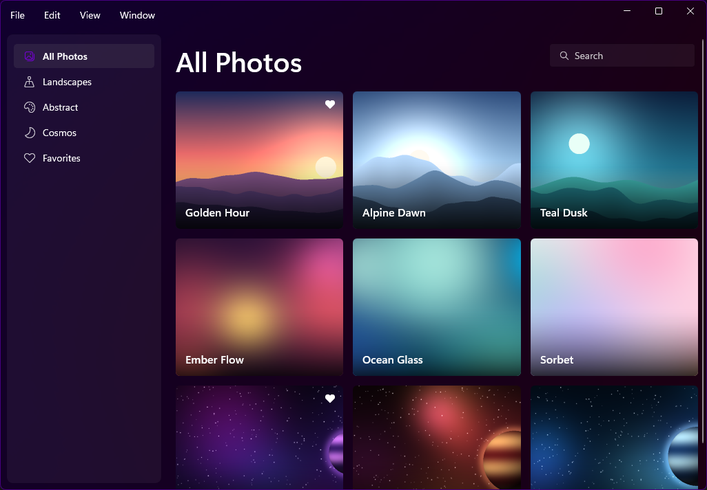
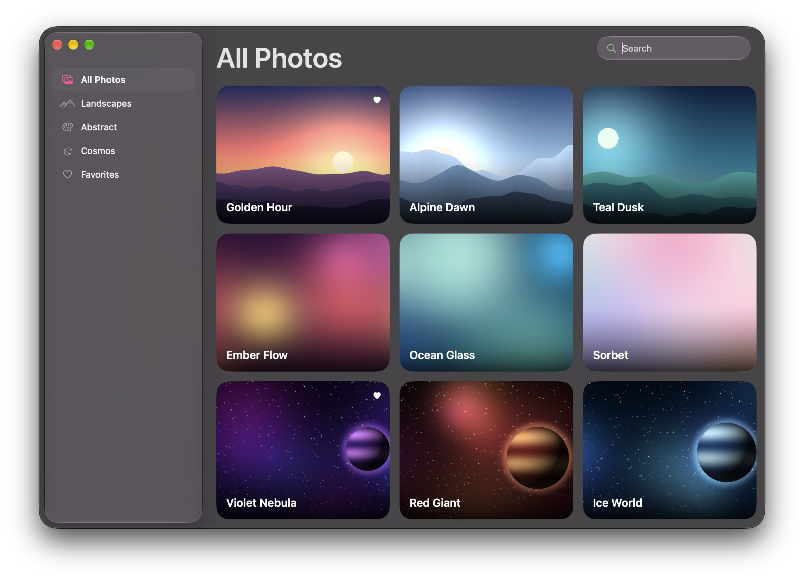
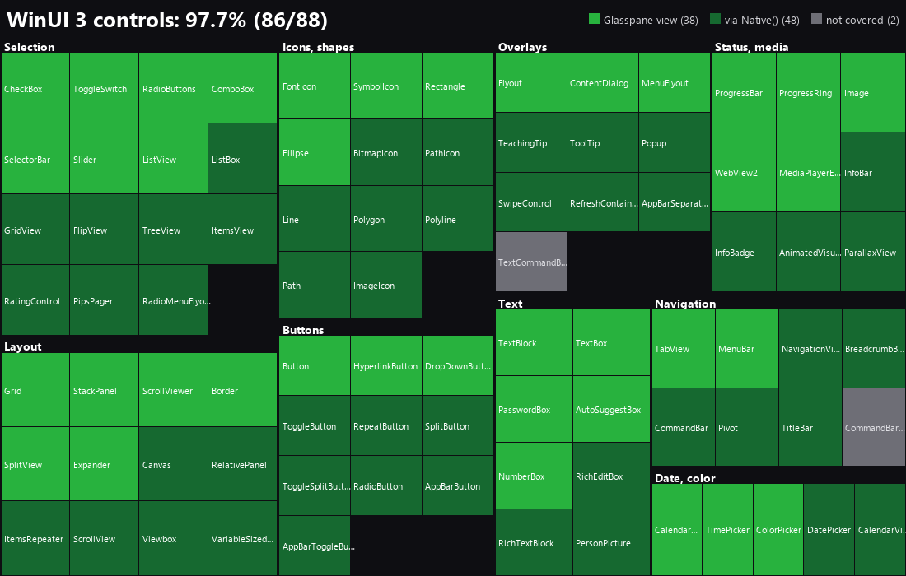
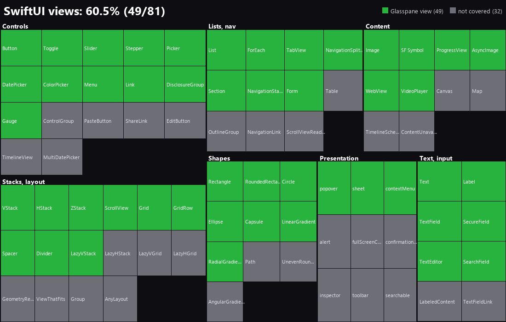

---

Build native desktop apps in JavaScript. You describe the UI with a SwiftUI-style API, and Glasspane renders it with WinUI 3 on Windows and SwiftUI on macOS. Your code runs on Node.js, so `fs`, `fetch`, databases and npm packages all work in event handlers.

```js
const { App, state, VStack, HStack, Text, Button, TextField } = require('@cryptidbleh/glasspane');

const count = state(0);
const name = state('');

App('Counter', () =>
  VStack(
    Text(`Count: ${count.value}`).font('largeTitle'),
    HStack(
      Button('-', () => count.value--),
      Button('+', () => count.value++).style('accent'),
    ),
    TextField('Your name', name),
    Text(`Hello, ${name.value || 'stranger'}`).foreground('secondary'),
  ).spacing(12).padding(32)
);
```

```
npx @cryptidbleh/glasspane app.js
```

On Windows the window uses the Mica backdrop, your system accent color, light and dark themes, and the standard Fluent controls. On macOS it is a SwiftUI window with system controls, colors and vibrancy. The same script runs on both.

*The Photos sample app (`examples/photos.js`) running the identical JavaScript codebase on both platforms:*

#### Windows 11 (WinUI 3)


#### macOS (SwiftUI)


### Element coverage

One tile per control. Bright green has its own Glasspane view. Dark green is a WinUI control you reach through `Native(...)`, on Windows only. Gray has no Glasspane view and no way in. SwiftUI has no `Native(...)`, so its chart is bright green and gray only. The lists are curated, not an exhaustive dump of each framework. `scripts/coverage-chart.py` redraws both charts.





## Contents

- [Getting started](#getting-started): [Windows](#windows), [macOS](#macos)
- [Building the UI](#building-the-ui): [State](#state-and-bindings), [Views](#views), [Modifiers](#modifiers), [Menus](#menus), [Icons](#icons), [Several windows](#several-windows)
- [System features](#system-features)
- [Cross-platform code](#cross-platform-code)
- [Packaging](#packaging)
- [How it works](#how-it-works), [Examples](#examples), [Limits](#limits)

## Getting started

### Windows

You need Windows 11 25H2 (build 26200) or newer (x64 or ARM64), [Node.js](https://nodejs.org) 20 or newer, and the [.NET SDK](https://dotnet.microsoft.com/download) 10 or newer. The first time you run an app, the SDK builds the host executable. After that you can run apps without .NET, because the host bundles its own runtime.

```
npm install @cryptidbleh/glasspane
npx @cryptidbleh/glasspane app.js
```

`node app.js` works too. It hands the script to `Glasspane.exe` and exits, so the app runs on its own like any other GUI program. Output from `console.log` still reaches the terminal, and the prompt returns right away.

Glasspane uses whichever Node.js you have installed, so it is not pinned to one version. Set `GLASSPANE_NODE` to a specific `node.exe` to choose one. `pack` uses that same variable when it bundles a runtime.

### macOS

You need macOS 27 or newer, [Node.js](https://nodejs.org) 20 or newer, and Xcode or the Command Line Tools (`xcode-select --install`, Swift 5.9 or newer). The first time you run an app, Swift builds the host.

```
npm install @cryptidbleh/glasspane
npx @cryptidbleh/glasspane app.js
```

Differences from Windows:

- `Native(...)` names a WinUI control, so it renders nothing on macOS, though its children still show. Add `.fallback(view)` to show something else there, or use the regular views if the app has to run on both.
- `backdrop` maps to a vibrancy material. `'mica'`, `'micaAlt'` and `'acrylic'` each get a different one, and `'none'` is the plain window color.
- `flex(n)` takes a share of the leftover space, but it ignores the weight `n`. Competing flex views split the space equally.
- `'mono'` uses the system monospaced font. Other Windows font names, such as `'Segoe UI'`, fall back to the system font.
- A Mac window has no icon of its own, so `window.icon` sets the Dock icon.
- `.glass(radius)` draws a translucent Liquid Glass surface behind a view. Windows draws a translucent Fluent card surface with a hairline edge instead. See [corner radius](#corner-radius-across-platforms) for scaling radii.
- `titleBar: 'hidden'` in the window options runs the content to the top edge of the window. On macOS the traffic lights float over it, so a sidebar can carry them (leave about 50 px of padding above its first row). On Windows the caption buttons float over the top right. `system.titleBarInsets` says how much room each side needs. macOS also uses `cornerRadius` (default 26) for the window's corners, because the system's own are tighter than a floating sidebar's. A sidebar inset by 8 points looks right with `glass(18 * system.softCornerRadiusMultiplier)`.
- `system.launch()` opens URLs in the default app. Windows protocols such as `ms-settings:` do nothing.

## Building the UI

### State and bindings

```js
const text = state('');
text.value = 'hi';              // re-renders
text.update(s => s + '!');      // updater function; you can also mutate an object and return nothing
```

Pass a `state` to an input and the two stay in sync, like SwiftUI's `$binding`:

```js
TextField('Search', query)
Toggle('Dark mode', dark)
Slider(volume, { min: 0, max: 100 })
Picker('Sort by', sort, ['Name', 'Date', { label: 'Size', value: 'bytes' }])
```

For a one-way value, pass a plain value and add `.onChange(fn)`. `Binding(get, set)` binds to anything else.

### Views

| Group | Views |
|---|---|
| Layout | `VStack` `HStack` `ZStack` `ScrollView` `Card` `List` `LazyVStack` `Grid` `GridRow` `SplitView` `TabView` `Tab` `NavigationStack` `DisclosureGroup` `Section` `Form` `Spacer` `Divider` |
| Content | `Text` `Label` `Link` `Icon` `Image` `WebView` `VideoPlayer` `ProgressView` `Gauge` `Spinner` `Rectangle` `RoundedRectangle` `Circle` `Ellipse` `Capsule` |
| Input | `Button` `Menu` `MenuItem` `TextField` `SecureField` `SearchField` `TextEditor` `Toggle` `Checkbox` `Slider` `Stepper` `Picker` `DatePicker` `ColorPicker` |
| Helpers | `ForEach(items, render)` for keyed lists, `Native(type, props, ...children)` |

Stacks accept a props object first, as in `VStack({ spacing: 12, alignment: 'leading' }, ...)`. The same options exist as modifiers. `Spacer()` and `.flex()` split whatever space is left in a stack.

#### Views that exist in both SwiftUI and WinUI

Each of these maps to a real control on both platforms:

| Glasspane | SwiftUI | WinUI |
|---|---|---|
| `TabView(index, Tab('One', ...), ...)` | `TabView` | `TabView` |
| `SplitView(sidebar, detail, { sidebarWidth })` | `NavigationSplitView` | `SplitView` |
| `DisclosureGroup(label, ...)` | `DisclosureGroup` | `Expander` |
| `Menu(label, MenuItem(...), Divider(), Menu(...))` | `Menu` | `DropDownButton` + `MenuFlyout` |
| `Grid(GridRow(a, b), GridRow(c, d))` | `Grid` | `Grid` with Auto rows and columns |
| `DatePicker(label, state, { mode })` | `DatePicker` | `CalendarDatePicker`, `TimePicker` |
| `ColorPicker(label, state)` | `ColorPicker` | `ColorPicker` |
| `SearchField(placeholder, state)` | a field with a magnifier | `AutoSuggestBox` |
| `Label(text, icon)`, `Link(text, url)` | `Label`, `Link` | icon and text, `HyperlinkButton` |
| `Picker(...).style('segmented' \| 'radio')` | `.segmented`, `.radioGroup` | `SelectorBar`, `RadioButtons` |
| `Button(...).style('plain' \| 'destructive')` | `.borderless`, destructive role | subtle button, critical text |
| `Rectangle` `RoundedRectangle` `Circle` `Ellipse` `Capsule` | the shapes | `Rectangle`, `Ellipse` |
| `.popover(open, ...)`, `.sheet(open, ...)` | `.popover`, `.sheet` | `Flyout`, `ContentDialog` |
| `.contextMenu(...)` | `.contextMenu` | `ContextFlyout` |
| `LazyVStack(items, render)` | `List` with plain style | `ListView` without selection |
| `WebView(url)`, `WebView({ html })` | `WebView` (`WKWebView`) | `WebView2` |
| `VideoPlayer(source)` | `VideoPlayer` | `MediaPlayerElement` |
| `RadialGradient(stops, center, radius)` | `EllipticalGradient` | `RadialGradientBrush` |

```js
const open = state(false);

Button('Options', () => { open.value = true; })
  .popover(open, { edge: 'bottom' }, Toggle('Enabled', enabled).padding(12))
  .contextMenu(MenuItem('Copy', copy).icon('copy').shortcut('CmdOrCtrl+C'), Divider(), MenuItem('Delete', del));

RoundedRectangle(12).foreground(LinearGradient(['#ff5f6d', '#ffc371'], 'topLeading', 'bottomTrailing'))
```

#### Views built from the others

`Section`, `Form`, `NavigationStack` and `Gauge` are assembled from the views above, so they look native on both platforms without any host code.

```js
Form(
  Section('Account', Toggle('Sync', sync), Picker('Plan', plan, ['Free', 'Pro'])),
  Section('Storage', Gauge('Disk', used, { min: 0, max: 512, format: (v) => `${v} GB` })),
)

const pages = state([]);
NavigationStack(pages, () => Home(), { title: 'Files' });
pages.update((p) => { p.push(() => Detail(id)); });   // push
pages.update((p) => { p.pop(); });                    // pop; the Back button does this
```

Pages are functions, so they re-render with your state. `LazyVStack` builds its rows as they scroll into view and has no selection. Use `List` when you need selection.

Notes:

- A popover or sheet is open while its state is true. Dismissing it from the outside sets a bound state back to false. A sheet has no close button of its own, so put one inside.
- `DatePicker` binds a `Date`. Picking a date keeps the time of day the value had.
- `Circle` is an ellipse on Windows, so give it a square frame. `ColorPicker` has no label on Windows.
- A gradient's theme-keyword stops (such as `'accent'`) are resolved when the view renders on Windows, so they do not follow a later theme change. Hex colors are fine.
- Segmented pickers have no label on Windows, and `SplitView` on macOS adds the system sidebar toggle.

#### Any WinUI control

On Windows, you can create a control Glasspane has no wrapper for by its type name. Properties are converted from JSON (enum names, colors, thickness, numbers), and events send back the control's current value. Add `.fallback(view)` to show something else on macOS, where `Native` renders nothing:

```js
Native('Expander', { Header: 'Advanced', IsExpanded: false }, Text('Hidden until opened'))
Native('CalendarDatePicker', { PlaceholderText: 'Pick a date' }).on('DateChanged', v => console.log(v))
Native('RatingControl', { Value: 3 }).on('ValueChanged', v => save(v)).fallback(Text('3 stars'))
```

### Modifiers

Modifiers chain and each returns a new view.

| Kind | Modifiers |
|---|---|
| Layout | `padding` `margin` `frame` `width` `height` `fill` `flex` `hAlign` `vAlign` |
| Text | `font` `bold` `italic` `underline` `strikethrough` `tracking` `textAlign` `lineLimit` `selectable` |
| Appearance | `foreground` `background` `border` `stroke` `cornerRadius` `glass` `opacity` `disabled` `hidden` `tooltip` |
| Transform | `offset` `rotation` `scale` `zIndex` |
| Behavior | `onTap` `onDoubleTap` `onHover` `onChange` `onSubmit` `on(event, fn)` `id(key)` `shortcut` `hitTesting` |
| Presentation | `contextMenu` `popover` `sheet` |
| Accessibility | `accessibilityLabel` `accessibilityHint` |

`font` takes a preset (`'largeTitle'`, `'title'`, `'title2'`, `'title3'`, `'headline'`, `'body'`, `'caption'`, `'mono'`), a size, or `{ size, weight, italic, family }`. Presets follow each platform's own type scale: the Fluent type ramp on Windows (`body` 14, `title` 28, `caption` 12) and the system text styles on macOS (`body` 13, `title` 22, `caption` 10). Pass a size to get the same number on both.

Colors can be `'#RRGGBB'`, a name such as `'red'`, or a theme keyword like `'accent'`, `'primary'`, `'secondary'`, `'card'` or `'danger'`. Theme keywords follow light and dark mode.

`foreground`, `font` and `disabled` set on a container apply to its children unless they set their own. `padding` sits inside the background and `margin` outside it.

#### Corner radius across platforms

Two multipliers let you write macOS-scale radii and get the right Fluent proportions on Windows:

- `system.cornerRadiusMultiplier` is `1` on macOS and `1/3` on Windows (a 3x ratio), for sidebar rows, tiles, search fields and controls.
- `system.softCornerRadiusMultiplier` is `1` on macOS and `0.5` on Windows (a 2x ratio), for cards and floating glass surfaces.

```js
const R  = system.cornerRadiusMultiplier;
const RS = system.softCornerRadiusMultiplier;
HStack(...).cornerRadius(12 * R)              // 12 on macOS, 4 on Windows
ZStack(...).cornerRadius(18 * R)              // 18 on macOS, 6 on Windows
VStack(...).glass(18 * RS)                    // 18 on macOS, 9 on Windows
```

### Menus

Give the window a `menu` and each platform builds its own menu bar: the macOS menu bar, or a bar at the top of the window on Windows.

```js
App({
  title: 'Notes',
  menu: () => [
    { label: 'File', items: [
      { label: 'New Note', shortcut: 'CmdOrCtrl+N', onClick: newNote },
      { label: 'Open Recent', items: recent.value.map((f) => ({ label: f, onClick: () => open(f) })) },
      '-',
      { label: 'Autosave', checked: autosave.value, onClick: () => { autosave.value = !autosave.value; } },
    ] },
    'edit', 'view', 'window',
  ],
}, body);
```

- `'edit'`, `'view'`, `'window'` and `'help'` are the usual menus, ready made. Edit works on the focused text field.
- An item has a `label`, an `onClick`, an optional `shortcut`, `enabled`, `checked` and `items` for a submenu. `'-'` is a separator, and falsy entries are skipped, so `cond && item` works.
- `role` picks a standard item (`'undo'`, `'redo'`, `'cut'`, `'copy'`, `'paste'`, `'selectAll'`, `'minimize'`, `'zoom'`, `'fullscreen'`, `'close'`, `'quit'`) and the host runs it. The label and shortcut default to the platform's.
- `CmdOrCtrl` in a shortcut is Command on macOS and Ctrl on Windows.
- Pass a function, as above, and it runs again on every render, so a checkmark or a disabled item follows your `state`.
- On macOS the app menu (About, Hide, Quit) always comes first, and the menu bar follows whichever window is in front. Without a `menu`, the Mac gets Edit and Window menus so copy and paste work. On Windows there is no menu unless you give one, so add `{ role: 'quit' }` to File.

### Icons

`Icon(spec)` and `Button(...).icon(spec)` accept a universal icon name (`'search'`, `'photos'`, `'heart'`, `'settings'`), an explicit `{ windows, macos }` pair, or a direct Windows `Symbol` or macOS SF Symbol name. Native symbol names map both ways automatically: `Icon('eye')` resolves to `'View'` on Windows, and `Icon('View')` resolves to `'eye'` on macOS. See [ICONS.md](ICONS.md) for the full mapping table.

#### App icon

One square PNG of 512 px or more is enough on both platforms. Glasspane turns it into an `.ico` on Windows and into an `.icns` with every size on macOS, so you never convert it yourself. `.ico` and `.icns` files are accepted as they are.

```js
App({ title: 'Notes', icon: 'icon.png' }, body)   // title bar and taskbar (Windows), Dock (macOS) while developing
```

`pack` also reads `"glasspane": { "icon": "icon.png" }` from `package.json`. Relative paths resolve from your script's folder, and `system.window.icon = 'other.png'` changes it at runtime. On Windows a PNG is stored in the `.ico` as a single image, which Windows scales for small sizes. For crisp 16 and 32 px icons there, pass your own multi-size `.ico`. The Mac `.icns` comes from `sips` and `iconutil`, so a PNG is only converted on a Mac.

### Several windows

Call `App()` more than once to open more windows. Each one keeps its own UI tree, state and window settings, and the process stays alive until the last one closes.

```js
const main = App('Notes', () => Text('Main window'));

const win = App({ title: 'Settings', width: 480, height: 360 }, () =>
  VStack(Text('Preferences'), Button('Close', () => win.close())).spacing(12).padding(24)
);

// Dialogs and window settings are per-window, so call them on the handle:
await win.confirm('Save changes?');
win.window.title = 'Settings (unsaved)';

// `system` without a window applies to whichever one is focused.
system.window.title = 'Notes';
```

`App()` returns that window's handle. Use `win.window` for its settings, `win.alert(...)` and the rest of the dialog API bound to it, and `win.close()` to close it. `system.windowOf(win)` gives you the same scoped API if you prefer to pass it around.

Closing the main window leaves the others running. `system.quit()` closes every window.

## System features

```js
const { system } = require('@cryptidbleh/glasspane');

await system.alert('Saved', { title: 'Done' });
if (await system.confirm('Delete everything?')) { /* ... */ }
const file = await system.openFile({ extensions: ['.png', '.jpg'] });
const out  = await system.saveFile({ name: 'notes.txt', extensions: ['.txt'] });
await system.clipboard.write('copied');
await system.launch('https://example.com');
system.window.title = 'Untitled (saved)';
system.quit();
```

These work on both platforms.

Window options go in the first argument to `App`:

```js
App({ title: 'Notes', width: 900, height: 640, backdrop: 'mica', theme: 'system' }, body)
```

- `backdrop` is `'mica'`, `'micaAlt'`, `'acrylic'` or `'none'`.
- `theme` is `'system'`, `'light'` or `'dark'`, and you can change it at runtime through `system.window.theme`.
- A new window puts keyboard focus on its first control. Set `autoFocus: false` to open with nothing focused and no focus ring.

## Cross-platform code

`system.platform` is `'windows'` or `'macos'`. For small differences, branch on `system.platform` or scale with the [corner radius multipliers](#corner-radius-across-platforms). For bigger ones, keep one file per platform and require the right one:

```js
const mod = system.platform === 'macos' ? '⌘' : 'Ctrl';
const shell = require(`./platform/shell.${system.platform}`);
Button(shell.revealLabel, () => shell.reveal(file)).icon('folder').cornerRadius(12 * system.cornerRadiusMultiplier);
```

`pack` copies the whole project, so every platform's file is included.

## Packaging

Run `pack` to turn an app into a standalone program that needs no installed Node, .NET, Swift or Glasspane:

```
npx glasspane pack app.js -n MyApp
```

Without a script, `pack` compiles the current folder. It looks for the `main` of `package.json`, then `app.js`, `index.js` and `main.js`, then a lone `.js` file:

```
npx @cryptidbleh/glasspane
```

Options:

| Option | Meaning |
|---|---|
| `-n <name>` | Name of the app. Defaults to `productName` or `name` from `package.json`. |
| `-o <dir>` | Output folder, relative to where you ran the command, or absolute. |
| `-i <icon.png>` | The icon (see [App icon](#app-icon)). |
| `--id <id>` | Bundle identifier on macOS, for example `com.you.app`. |

Run `npm install --omit=dev` in your project first so dev dependencies stay out of the package.

### Windows

`pack` writes `./MyApp/` in the folder you ran it from. It holds `MyApp.exe`, the WinUI host, a copy of `node.exe`, and an `app/` copy of your project including `node_modules`. Zip the folder and ship it. `MyApp.exe` runs on a double-click.

The result is a folder because WinUI and the Node runtime have to sit next to the exe. The bundled `node.exe` is about 90 MB, which is most of the folder.

To change the icon of an exe you already packaged:

```
npx glasspane icon MyApp/MyApp.exe icon.png
```

That changes the file icon shown in Explorer, pinned taskbar entries and shortcuts, using the pure-JS `resedit` (no native binary required).

### macOS

`pack` writes `./MyApp.app`, a bundle with the SwiftUI host, a copy of `node` and your project. The bundle is signed ad hoc, which is enough to run on the Mac that built it. Before you give it to other people, sign it with a Developer ID and notarize it. Glasspane does neither. Bundle the `node` from nodejs.org (set `GLASSPANE_NODE`), because a Homebrew `node` links libraries that other Macs lack. Icons are `.icns` files, or a `.png` that `pack` converts with `sips`.

## How it works

On Windows, `Glasspane.exe` is a WinUI 3 program. On macOS it is a SwiftUI app that speaks the same protocol. Either one starts a stock Node.js as a child process, and the two talk over stdin and stdout using newline-delimited JSON. Nothing is embedded, so any current Node.js release works.

```
Glasspane.exe            your app runs in a child process
├── UI thread            WinUI 3 controls
└── node.exe             your script, npm packages, fs, fetch
        ⇅ newline-delimited JSON over stdin/stdout
```

Every message carries a window id, so the host routes it to the right native window. Since stdout is the protocol channel, `console.log` and everything else the app prints goes to stderr, which the host forwards to the terminal. Writing to stdout directly is ignored with a warning.

Your `body` function returns a description of the UI. It runs again whenever a `state` changes or an event handler finishes, but only for the windows that read that state. The host compares the new description with the controls it already has and updates only what differs, so focus, caret position and scroll position survive a re-render.

## Examples

```
glasspane examples/counter.js   # state, buttons, text field, toggle, slider
glasspane examples/todo.js      # keyed lists, universal icons, dialogs, save picker
glasspane examples/photos.js    # glass sidebar & search pill, menus, cornerRadiusMultiplier, universal icons
glasspane examples/gallery.js   # every control, Form, Gauge, LazyVStack, WebView, Native views, ZStack
glasspane examples/views.js     # tabs, split view, menus, grid, pickers, shapes, popovers, sheets, NavigationStack, VideoPlayer
glasspane examples/windows.js   # several windows, shared state, per-window dialogs
glasspane examples/platform.js  # system.platform and one file per OS
```

## Limits

- Node.js runs as a child process rather than inside the host, so Task Manager (Activity Monitor on macOS) shows two entries while an app runs. In return, you are not pinned to one Node version.
- stdout belongs to the protocol, so `console.log` is routed to stderr. A library that writes to `process.stdout` directly is ignored with a warning, so it cannot corrupt the message stream.

TypeScript definitions ship in `index.d.ts`.
